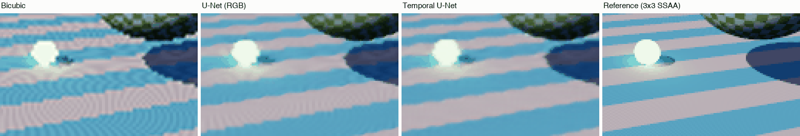
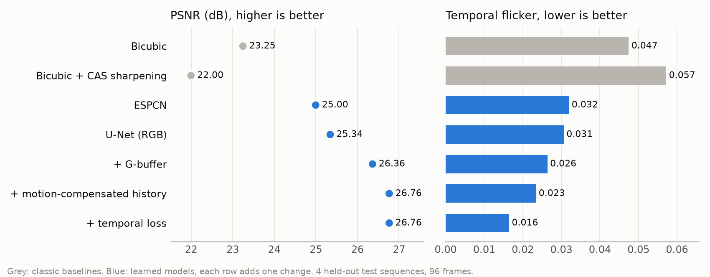
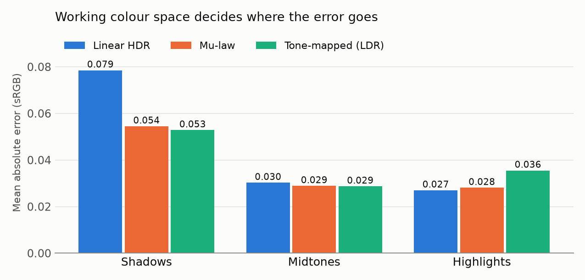
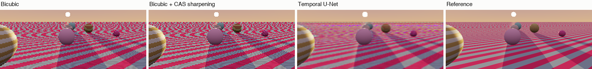

# Neural Temporal Super-Resolution for Rendered Frames

A DLSS-style temporal upscaler built from scratch: a procedural renderer that produces jittered,
aliased HDR frames with G-buffers and motion vectors, a recurrent U-Net that turns them into
anti-aliased 2x frames, and controlled experiments on colour space, renderer inputs and losses.



*Zoomed ground texture during a camera move (3x nearest-neighbour). Bicubic keeps the moiré rings
and jaggies of the 1-sample-per-pixel input, and they crawl from frame to frame. The temporal
U-Net (G-buffer + motion-compensated history + temporal loss) removes them and stays stable.*

<picture>
  <source media="(prefers-color-scheme: dark)" srcset="assets/ablation_dark.png">
  
</picture>

**+3.5 dB PSNR and 65% less temporal flicker than bicubic.** Sharpening (CAS, as in FSR 1) makes
aliased input *worse*. The biggest gains come from the renderer's own data: G-buffer (+1.0 dB)
and the motion-compensated history (+0.4 dB, −11% flicker); a temporal loss then cuts flicker
by another 29% at equal PSNR.

<picture>
  <source media="(prefers-color-scheme: dark)" srcset="assets/colorspace_dark.png">
  
</picture>

**Where the network works matters.** Training on linear HDR lets bright pixels dominate the loss
(+44% shadow error); tone-mapping before upscaling throws away highlight detail (+26% highlight
error). A mu-law encoding balances both.



*Failure case worth showing: at sunset the temporal model (G-buffer + history + temporal loss)
removes the moiré but over-smooths the distant stripes and leaves a faint colour fringe at the
horizon, where the texture is far beyond what a 192x108 input can resolve.*

## 1. Objective

Real-time renderers increasingly draw frames at a reduced resolution and reconstruct the
display-resolution image with a neural network (e.g. DLSS, FSR, XeSS). This project builds a
small version of that pipeline from scratch and studies the design choices behind it.

The network receives what a game engine would provide: a jittered, aliased low-resolution HDR
frame, its G-buffer (normals, albedo, depth) and motion vectors. It must produce a 2x frame that is
anti-aliased, tone-mapped for display and stable over time.

The project has three goals:

1. Build a synthetic dataset with renderer-side inputs and supersampled ground truth.
2. Implement classic and learned upscalers, including a recurrent temporal model.
3. Run controlled experiments on colour space, renderer inputs, loss functions and quantisation,
   and analyse the results with fidelity, temporal and image-processing metrics.

## 2. Research questions

| Exp. | Question | Runs |
|---|---|---|
| **E1** Baselines | How much does a learned model improve on classic upscaling? | `bicubic`, `cas` (bicubic + contrast-adaptive sharpening, FSR 1-style), `espcn`, `liteunet` |
| **E2** Colour space / dynamic range | Should the network work on linear HDR, a log-like (mu-law) encoding, or the tone-mapped sRGB image? | `e1_liteunet` (mu-law), `e2_linear`, `e2_ldr` |
| **E3** Renderer inputs | What do G-buffers and a motion-compensated history frame add? | `e3_gbuffer`, `e3_gbuffer_history` |
| **E4** Losses | Perception–distortion trade-off and temporal stability | `e4_l1_ssim`, `e4_l1_fft`, `e4_history_tloss` |
| **E5** Model size / quantisation | Quality vs. model size, and what INT8 quantisation costs | `e5_w8`, `e5_w32` (not run yet), INT8 PTQ of `e1_liteunet` |

## 3. Dataset: a procedural ray-caster

`lu/render.py` is a vectorised ray-caster written in PyTorch. It renders 24 camera fly-throughs
(20 train / 4 test, 24 frames each) of procedurally generated scenes:

* textured ground with high-frequency patterns (checker + stripes, tiles with thin grout,
  rings, wood grain) that alias and moiré when minified, which is the core problem upscalers face
* spheres with striped/checker albedo, Blinn-Phong highlights and hard sun shadows
* **day / sunset / night** lighting presets; night scenes are lit by emissive spheres, so the
  dynamic range varies widely; per-sequence auto-exposure (key 0.18)
* orbit, strafe and dolly camera paths
* **LR input** (192x108): 1 sample per pixel at a per-frame Halton(2,3) sub-pixel jitter, like
  TAA/TAAU input, with world normals, albedo, view depth and motion vectors
* **HR target** (384x216): 3x3 supersampled (anti-aliased) radiance, plus motion vectors and
  reprojected depth for warping and disocclusion masks

Everything is stored as linear HDR. Display images use exposure, the ACES filmic curve and the sRGB OETF.

## 4. Methods

**Baselines.** Bicubic interpolation, and bicubic followed by contrast-adaptive sharpening
(written from the published CAS idea, not a bit-exact port of AMD's shader).

**Learned models.** All predict a residual over bilinear upsampling and use a pixel-shuffle x2 head.

* **ESPCN** (Shi et al., 2016): three convolutions, 8.8k parameters.
* **U-Net** (`LiteUNet` in `lu/models.py`): two-scale U-Net at LR resolution with 3x3
  convolutions, 37k parameters.
* **Temporal variant**: the previous output is backward-warped with motion vectors and masked
  where the reprojected depth disagrees with the previous depth buffer (disocclusion). It is then
  space-to-depth packed to LR resolution and concatenated to the input. This is a recurrent
  temporal upscaler, simplified from Xiao et al., *Neural Supersampling for Real-time Rendering*, 2020.

**Training.** 48x48 LR patches, batch 16, AdamW (lr 2e-3), warmup + cosine schedule, 20k
iterations. Temporal models use a two-frame unroll. Losses: L1, SSIM, FFT amplitude, and a
temporal loss that matches the output's frame-to-frame change to the reference's.

**Evaluation.** Full test frames, run in order (recurrently for temporal models), in display sRGB:

* **Fidelity:** PSNR, SSIM, CIE76 ΔE*ab colour error (CIELAB)
* **Temporal stability:** frame-to-frame change of the output minus that of the reference,
  on validly reprojected pixels (flicker / ghosting)
* **Image-processing analysis:** local and global contrast ratio, sharpness ratio (Laplacian
  energy vs. reference), error in shadows / midtones / highlights, extra highlight clipping,
  error on edges vs. flat regions, PSNR per lighting preset
* **Model cost:** parameters, multiply-accumulates (MACs) for a 960x540 -> 1080p upscale, and
  the quality change after INT8 post-training quantisation

## 5. Results

4 held-out test sequences (96 frames), single training seed. Full table in [`results/summary.md`](results/summary.md),
image crops in [`results/comparison.png`](results/comparison.png).

| Run | Params | GMACs@1080p | PSNR | SSIM | ΔE | Flicker |
|---|---|---|---|---|---|---|
| bicubic | 0 | – | 23.25 | 0.696 | 9.11 | 0.0475 |
| CAS-style | 0 | – | 22.00 | 0.654 | 10.71 | 0.0572 |
| ESPCN | 8.8k | 4.5 | 25.00 | 0.748 | 7.34 | 0.0320 |
| U-Net (mu-law, L1) | 36.9k | 6.5 | 25.34 | 0.747 | 7.08 | 0.0306 |
| + G-buffer | 38.2k | 7.2 | 26.36 | 0.781 | 6.27 | 0.0264 |
| + G-buffer + history | 40.1k | 8.1 | 26.76 | 0.787 | 6.07 | 0.0234 |
| + history + temporal loss | 40.1k | 8.1 | **26.76** | **0.787** | 6.16 | **0.0165** |

## 6. Discussion

* **E1. Sharpening hurts on aliased input.** CAS is 1.25 dB below bicubic, flickers 20% more,
  and has 1.43x the reference's local contrast: it amplifies jaggies and moiré along with real
  detail. The U-Net beats bicubic by 2.1 dB. ESPCN gets most of that gain (1.75 dB) with a
  quarter of the parameters.
* **E2. The working colour space decides where the error goes.** Linear HDR has the lowest
  highlight error but 44% more shadow error than mu-law (0.079 vs. 0.055), because L1 is
  dominated by bright pixels. Tone-mapping first (LDR) has 26% more highlight error (0.036 vs.
  0.028), because the ACES shoulder compresses highlights before the network sees them. Mu-law
  is the best overall (25.34 vs. 24.94 / 25.15 dB).
* **E3. Renderer inputs give the largest gains.** The G-buffer adds 1.0 dB, cuts edge error by
  11% and flicker by 14%. The motion-compensated history adds another 0.4 dB and cuts flicker by
  a further 11%, with the largest gain at sunset (+0.7 dB).
* **E4. Temporal stability vs. detail.** The temporal loss cuts flicker by 29% (0.0234 → 0.0165)
  at equal PSNR. Part of that comes from smoothing: the sharpness ratio drops from 0.46 to 0.36,
  shadow error rises 12%, and sunset PSNR falls 0.9 dB, with a faint colour fringe near the
  horizon. L1+SSIM gives a small SSIM gain (+0.009). The FFT loss at weight 0.05 had no
  measurable effect.
* **INT8 post-training quantisation** of the U-Net costs 0.02 dB PSNR and 0.009 SSIM.
* **Caveats.** All learned models are blurrier than the reference (sharpness ratio ≈ 0.45): far
  stripe textures are smoothed out instead of resolved. The higher sharpness ratios of bicubic
  (0.73) and CAS (0.99) are inflated by aliasing energy, so the ratio is not a clean detail
  measure on aliased inputs. Differences under ~0.1 dB (FFT, SSIM-loss PSNR) are within
  single-seed noise.

## 7. Limitations and future work

* The scenes are simple (spheres and a plane, no transparency, particles, reflections or animated
  objects), so absolute numbers do not transfer to real games. The comparisons between design
  choices are the point, and history-related failure cases (ghosting) are under-represented.
* No classic temporal baseline yet: a TAAU-style accumulator with neighbourhood clamping would be
  the fair reference for the temporal models.
* Perceptual metrics (LPIPS, ꟻLIP) and VLM-based image quality assessment are natural additions.
* Model-size sweep (E5: widths 8 and 32) still to run.

## 8. Running it

```bash
python3.11 -m venv .venv && .venv/bin/pip install torch numpy pillow matplotlib
./run_all.sh          # data -> trainings -> evaluation -> benchmark
```

Or step by step:

```bash
.venv/bin/python generate_data.py                 # ~0.9 GB in data/
.venv/bin/python train.py configs/e1_liteunet.json
.venv/bin/python evaluate.py                      # every trained run + baselines
.venv/bin/python benchmark.py --int8 e1_liteunet  # parameters, MACs, INT8 quantisation
```

## 9. Layout

```
lu/render.py    ray-caster, scenes, camera paths, jitter, motion vectors
lu/color.py     ACES, sRGB, mu-law, CIELAB; network working domains
lu/data.py      dataset generation, patch sampling, input assembly
lu/models.py    bicubic, CAS-style sharpening, ESPCN, U-Net, warping
lu/losses.py    L1, SSIM, FFT amplitude, temporal
lu/metrics.py   PSNR, SSIM, ΔE, temporal flicker, contrast/sharpness/dynamic-range analysis
configs/        one JSON per experiment run
train.py  evaluate.py  benchmark.py  generate_data.py  run_all.sh
```
